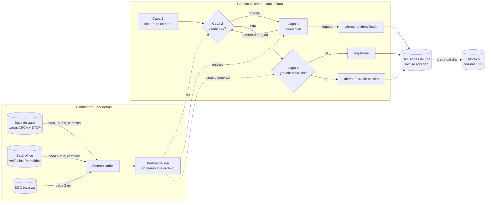

# En vivo: padrón del día y las cuatro capas

27/10/2026. Cómo se valida cada lectura de cámara **en el momento**, sin consultar a nadie por cada camión, y cómo se separa el en vivo del histórico.

## La idea

Hoy cada lectura tendría que preguntarle a la API (`register`) quién es el camión: es lento, escribe una lectura por consulta y no escala.
Al revés: **traemos por detrás, cada pocos minutos, todo lo que sabemos de quién puede venir hoy** y lo dejamos en un **padrón del día** en memoria.
Cada lectura solo busca en ese padrón: sin red, en milisegundos.

## Camino frío: el padrón

### Qué entra

| Fuente | Qué aporta | Cada cuánto | Cómo |
|---|---|---|---|
| **Cartas con destino a Vicentin** (base de agro) | Camiones que vienen a descargar: patentes, CTG, grano, turno, partida, km | 15 min | API de agro con llave de soporte, pidiendo **solo lo modificado** desde la última vez |
| **Cartas emitidas por Vicentin** (base de agro) | Camiones que **salen** cargados: lo que tiene que pasar por la salida | 15 min | ídem |
| **Turnos STOP, terminal 12** | Cupo del día, turnos sin carta (cupo libre), estado de cada turno | 30 min (tope de la API: 48 consultas/día) | Endpoint de agro (pedido a Miqueas) |
| **Vehículos Permitidos** (back office, otro sistema) | Utilitarios, servicios y flota interna: patente, sectores, horario, vigencia | 5 min | API del back office (contrato abajo) |
| **SGC** (balanza) | Si ya entró o salió, qué cargó o descargó | 2 min | Ya existe (`server/sgc`) |

Qué ventana se trae: cartas con turno de **ayer, hoy y mañana**, cartas activas sin turno de los últimos 3 días y cartas emitidas en las últimas 48 h.
Son **unas 150 a 400 patentes por día**: el padrón entero entra en memoria.

### Qué guarda por patente

Índice `Map<patente normalizada, entrada>`, con **chasis y acoplado** como claves (las cámaras traseras leen el acoplado).

| Campo | Ejemplo |
|---|---|
| quién es | CTG, transportista, grano, planta de destino, turno STOP · o «vehículo permitido: agua, sectores X, Y» |
| qué se espera | sentido (entra a descargar / sale cargado / interno), circuito esperado, ventana de llegada |
| en qué estado está | esperado → visto → en planta → salió · o no vino |
| de dónde salió el dato | fuente y versión del padrón |

El estado lo mueven las lecturas y el SGC. De ahí salen **directamente** las vistas «Esperados hoy», «Cumplimiento de ayer» y «Cupo libre»: no son cálculos aparte.

### Reglas que ya están medidas y van al padrón

- **La planta de la carta no es el sitio**: lo que descarga en Ricardone viaja con carta a la 25567 (San Lorenzo). El padrón es del **Nodo Sur**, no de una planta.
- **La partida declarada no es confiable**: 71 de 482 camiones entraron antes de su partida (mediana 3,4 h). La ventana de llegada se calcula con el turno STOP, no con la partida.
- **1 de cada 5 llega un día tarde**: los turnos de ayer sin llegar siguen en el padrón hoy.
- **La flota interna** (por ejemplo, girasol de Chief 3: entra vacía, 2 o 3 vueltas por día) no tiene carta de entrada: va como **Vehículo Permitido / interno**, no como faltante.

### Persistencia

- En memoria para leer; una foto en `data/padron/<día>.json` (escritura atómica) para que un reinicio arranque al instante.
- Cada sincronización sube la **versión del padrón**; cada decisión guarda con qué versión se tomó (auditable).
- Si agro no responde, el padrón sigue con lo último y marca su **antigüedad**.

## Camino caliente: cada lectura

Presupuesto: **menos de 50 ms por lectura, sin red.** Todo lo que necesita ya está en memoria.

| Capa | Qué hace | Con qué |
|---|---|---|
| **1. Lectura** | Llega el evento de cámara: patente leída, cámara, hora operativa, foto | Feed de TruckFlow (hoy cada 10 s; a futuro, push de Enesimal) |
| **2. ¿Quién es?** | Busca la patente exacta en el padrón (chasis o acoplado) | `Map` del padrón · Vehículos Permitidos |
| **3. Corrección** | Si no está: busca la patente **dentro del universo del padrón** (los abiertos de hoy, no cualquier patente) por similitud, color/marca/tamaño en nodos anteriores y la base histórica corregida. Si encuentra, **vuelve a la capa 2** con la patente corregida | `plateSimilarity`, modelo de nodos, decisiones previas (ya existen en `server/plantState`) |
| **4. ¿Puede estar ahí?** | Compara el punto de la lectura con lo que le toca: camión → su circuito (grano + destino + sentido); vehículo permitido → sus sectores y horario | Circuito esperado del padrón · catálogo de circuitos del modelo de nodos |

Por qué el universo del padrón hace la diferencia: corregir contra ~300 patentes esperadas es mucho más preciso que contra cualquier patente posible. Es el enfoque de «lote como universo conocido», que ya validamos.

### Lo lento no frena

- **Reconocimiento por imagen (IA + base vectorial)**: corre **por detrás** sobre las lecturas no resueltas. Si después identifica una, actualiza la decisión. La alerta queda como «pendiente de imagen», no como definitiva.
- **Carta emitida hace minutos** (todavía no sincronizada): si una patente no está y el padrón tiene más de 15 min, la lectura queda **«pendiente de padrón»** y se reevalúa sola en la próxima sincronización. Recién ahí, si sigue sin aparecer, es alerta.

### Lo que sale

Cada lectura produce **una decisión**, que se agrega a `data/live/decisiones/<día>.jsonl` (solo se agrega, nunca se edita): patente leída, patente final, capa que resolvió, entrada del padrón, resultado (registrado / no identificado / fuera de circuito / pendiente) y versión del padrón.
Las alertas son decisiones con resultado negativo: se publican en el stream de En vivo.

## En vivo e histórico, separados

| | En vivo | Histórico |
|---|---|---|
| Pregunta | ¿Quién es, dónde está, puede estar ahí? **Ahora** | ¿Qué pasó? Tiempos, circuitos, comités |
| Datos | Padrón del día + últimas 24 h de lecturas | Ventanas semanales (`runs/windows/…`) |
| Fuentes | Las del camino frío | Lecturas crudas de TruckFlow + movimientos SGC + **lo que decidió el en vivo** |
| Código | `server/live/…` (padrón, sincronizador, capas) y `server/plantState` | `src/etl-core`, corridas ETL |
| Escribe | Decisiones del día (solo agregar) | Tablas de la corrida |

**El contrato entre los dos:**
- **Del en vivo al histórico:** al cierre de cada día se congela el padrón final + las decisiones + las alertas del día. El ETL los toma como una fuente más, igual que hoy toma las correcciones (`/api/truckflow/live/corrections`). Así el histórico reproduce exactamente lo que decidió el en vivo.
- **Del histórico al en vivo:** solo **parámetros precalculados** (tiempos de tránsito por tramo, probabilidad de inicio por nodo, base de patentes corregidas), regenerados de noche y cargados al arrancar. El en vivo nunca corre una consulta histórica en el camino caliente.

## Contrato con el back office de Vehículos Permitidos

Lo arma otro equipo; acá solo lo leemos. Necesitamos:

- `GET /vehiculos-permitidos?modificados_desde=<fecha>`: patente (y acoplado si aplica), tipo (utilitario, servicio, flota interna), sectores permitidos, horario y días, vigencia desde/hasta, estado (habilitado / suspendido), titular y sector responsable.
- Opcional: aviso (webhook) cuando cambia uno, para no esperar los 5 minutos.

Lo que el en vivo le devuelve, si lo quieren: las patentes **no identificadas** y las **fuera de recorrido**, para que el sector las dé de alta o las corrija.

## Etapas

| # | Qué | Depende de | Listo cuando |
|---|---|---|---|
| 1 | **Padrón + sincronizador de cartas** (destino y emitidas). «Esperados», «Cumplimiento» y «Cupo» leen del padrón | Llave de soporte de agro | Esperados de hoy coincide con los ingresos SGC del día (medido) |
| 2 | **Capa 2 en vivo**: cada camión de En vivo muestra quién es según el padrón | 1 | Toda lectura de cámara tiene su decisión en `decisiones/<día>.jsonl` |
| 3 | **Capa 3 con el padrón como universo** | 2 | Replay de una semana: más acierto y menos errores que la corrección actual (`replay-algoritmo.mjs`) |
| 4 | **Capa 4**: circuito esperado del padrón vs punto leído; alertas | 2 | Replay sin falsas alertas de la flota interna |
| 5 | **Vehículos Permitidos** desde el back office | Contrato del back office | Los utilitarios dejan de alertar |
| 6 | **STOP**: cupo libre, turnos sin carta | Endpoint de agro | El cupo del día cierra contra STOP |
| 7 | **Cierre del día → histórico** | 2 | La corrida semanal toma las decisiones del en vivo |

Lo que ya existe y se reusa: el servicio de estado de planta (`server/plantState`), la identificación y corrección de patentes (`plateIdentification.mjs`, modelo de nodos), el SGC, y el módulo de cartas (`server/agro/cartaPorte.mjs`), que pasa a ser el sincronizador del padrón en vez de leer el JSON exportado a mano.
